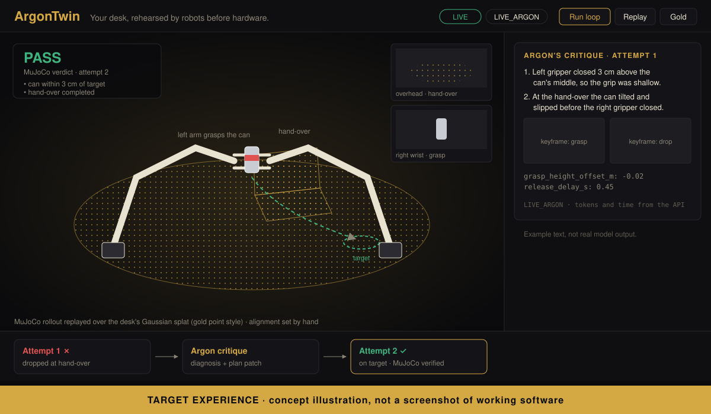
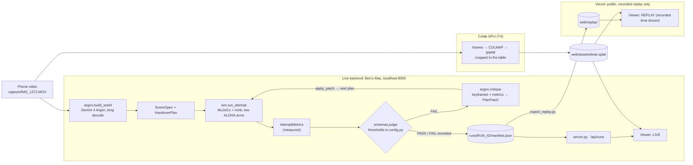

# ArgonTwin

**Your desk, rehearsed by robots before hardware.**

A 10-second phone video of a real workspace becomes a 3D Gaussian splat and a MuJoCo physics twin. Two ALOHA arms are placed on the desk and asked to hand a can from one to the other. Gemini 4 Argon watches each simulated attempt, explains why it failed, and patches the plan. MuJoCo, not the model, decides when it has worked.

**Hosted page: [argon-twin.vercel.app](https://argon-twin.vercel.app)** is a labeled TARGET PREVIEW (concept), not the live app. Hosted replay of recorded runs comes later; live runs happen on the local backend.

Built at the [Gemini 4 Argon SF Hackathon](https://cerebralvalley.ai/events/~/e/gemini-4-argon-sf) (Google DeepMind × Cerebral Valley, SHACK15, Oct 25, 2026) for Problem Statement Two, *More Dimensions*: render what it made, watch the result, critique it against the goal, fix it in a loop.



*Target experience: a concept illustration of what we are building, not a screenshot. The critique text in it is an example, not model output.*

## How it works



- **Pass/fail is deterministic.** `schemas.judge` checks measured MuJoCo metrics against fixed thresholds in `config.py`: hand-over completed, no drop, can within 3 cm of the target and at rest, no hard arm-table contact. Checks proposed by Argon are shown as extra information and never change the verdict.
- **Live versus hosted.** MuJoCo and every Gemini call run only on the local backend. The Vercel site plays recorded runs and labels them `REPLAY` with the time they were recorded; it holds no keys and makes no model calls.
- **Argon's long output (planned, after the core hand-over works).** A one-pass long-decode demonstration that generates a larger scene/controller/test package in one background call, reporting output tokens and thinking tokens separately, exactly as the API returns them. No run has yet produced more than 65,536 output tokens; that proof is still to come. The core contracts don't depend on it.

## Status (Oct 25, 2026)

| Part | Owner | Status |
|---|---|---|
| `schemas.py`, `config.py`: contracts, interfaces, judge, thresholds | Claude | Done, frozen at contract 1.0.0 |
| `loop.py`, `server.py`, `export_replay.py` | Claude | Written; tested end to end with stand-in sim and Argon modules, not yet with the real ones |
| `web/`: 3D viewer (rollout replay, splat in gold or true color, critique rail, filmstrip, LIVE/REPLAY labels) | Claude | Written; not yet run against a real rollout or splat |
| `sim.py` + physics tests | Codex | In progress: loads and steps the real ALOHA model and produces genuine failed hand-over rollouts with 20 keyframe PNGs. No passing hand-over yet |
| `capture/`: splat from `IMG_1272.MOV` | Codex | Reconstruction running on a Colab T4 (feature extraction and matching); splat training not started |
| `argon.py`, `managed_agent.py` | Antigravity | Files exist; integration not yet verified. A direct `gemini-4-argon` Interactions call was verified earlier |
| Hosted page on Vercel | — | [argon-twin.vercel.app](https://argon-twin.vercel.app): TARGET PREVIEW (concept) is live. Recorded replay is not hosted yet |

Everything in this repo was written during the event.

## Running it

Requirements: Python 3.12, `mujoco`, `mink`, `robot_descriptions`, `google-genai`, `pydantic`, `fastapi`, `uvicorn`. A `requirements.txt` lands with `sim.py`.

```bash
uvicorn server:app --port 8000          # live viewer at http://127.0.0.1:8000
python loop.py --scene examples/desk_manual.json   # hand-written scene, Argon critiques
python loop.py --video capture/IMG_1272.MOV        # Argon builds the scene from the video
python export_replay.py <run_id>        # copy a finished run into web/replay/ for the hosted viewer
```

`GEMINI_API_KEY` is read from the environment or a local `.env`, which is never committed.

## Known gaps

- No passing hand-over yet, and `argon.py` / `managed_agent.py` haven't been run through `loop.py`, so there is no verified end-to-end run.
- The splat reconstruction is still running; until it lands, the viewer draws a plain table.
- The hosted page is a concept preview; recorded replay isn't hosted yet.
- Splat-to-sim alignment is set by hand (`web/assets/align.json`).
- If friction grasping proves unreliable, `sim.py` may attach the can with a weld; the viewer shows `grasp assist: weld` whenever that happens.
- The world build is a long call (minutes), so the live demo runs the critique loop live and shows the world build's recorded result.

## Open-source parts we use (not built today)

- [MuJoCo](https://github.com/google-deepmind/mujoco) and the ALOHA model from [MuJoCo Menagerie](https://github.com/google-deepmind/mujoco_menagerie)
- [mink](https://github.com/kevinzakka/mink) for inverse kinematics
- [gsplat](https://github.com/nerfstudio-project/gsplat) for splat training, [COLMAP](https://colmap.github.io/) for camera poses
- [Three.js](https://threejs.org/) for the viewer

## Models

- `gemini-4-argon` through the Gemini Interactions API
- `antigravity-preview-09-2026` managed agent with `gemini-4-argon`

Full plan and contracts: [`docs/BUILD-SPEC.md`](docs/BUILD-SPEC.md).
