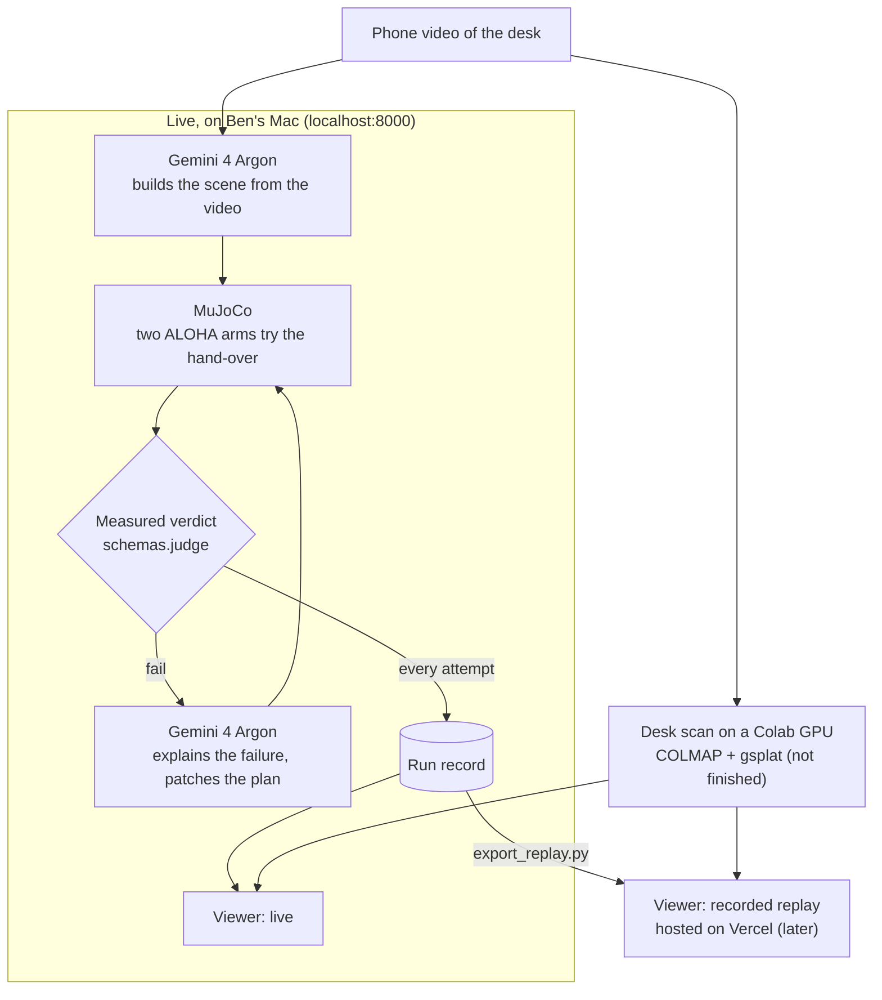

# ArgonTwin

**Your desk, rehearsed by robots before hardware.**

A 10-second phone video of a real workspace becomes a 3D Gaussian splat and a MuJoCo physics twin. Two ALOHA arms are placed on the desk and asked to hand a can from one to the other. Gemini 4 Argon watches each simulated attempt, explains why it failed, and patches the plan. MuJoCo, not the model, decides when it has worked.

**Hosted page: [argon-twin.vercel.app](https://argon-twin.vercel.app)** is a labeled TARGET PREVIEW (concept), not the live app. Hosted replay of recorded runs comes later; live runs happen on the local backend.

Built at the [Gemini 4 Argon SF Hackathon](https://cerebralvalley.ai/events/~/e/gemini-4-argon-sf) (Google DeepMind × Cerebral Valley, SHACK15, Oct 25, 2026) for Problem Statement Two, *More Dimensions*: render what it made, watch the result, critique it against the goal, fix it in a loop.


*Target experience: a concept illustration of what we are building, not a screenshot. The critique text in it is an example, not model output.*

## How it works



- **Pass/fail is deterministic.** `schemas.judge` checks measured MuJoCo metrics against fixed thresholds in `config.py`: hand-over completed, no drop, can within 3 cm of the target and at rest, no hard arm-table contact. Checks proposed by Argon are shown as extra information and never change the verdict.
- **Live versus hosted.** MuJoCo and every Gemini call run only on the local backend. The Vercel site plays recorded runs and labels them `REPLAY` with the time they were recorded; it holds no keys and makes no model calls.
- **Argon's long output (planned, after the core hand-over works).** A one-pass long-decode demonstration that generates a larger scene/controller/test package in one background call, reporting output tokens and thinking tokens separately, exactly as the API returns them. No run has yet produced more than 65,536 output tokens; that proof is still to come. The core contracts don't depend on it.

## Status (Oct 25, 2026)

| Part | Owner | Status |
|---|---|---|
| `schemas.py`, `config.py`: contracts, interfaces, judge, thresholds | Claude | Done, frozen at contract 1.0.0 |
| `loop.py`, `server.py`, `export_replay.py` | Claude | Committed. Tested end to end with stand-in sim and Argon modules; not yet run with the real ones together |
| `web/`: viewer (stage, loop rail, MuJoCo verdict, critique subtitles, gold / photoreal / off scan modes, live vs replay label) | Claude | Committed. Checked in a browser with the real passing MANUAL rollout; scan modes checked only with a synthetic test splat, since no desk splat exists yet. Arms render with the real ALOHA meshes (`web/assets/meshes/`) |
| `sim.py` + `tests/test_sim.py` | Codex | A hand-written (MANUAL) plan passes the MuJoCo hand-over with weld grasp assist, with 20 rendered keyframes (`runs/verified-manual/attempt-1`). 3 tests pass: nominal hand-over with exact repeatability, an unreachable hand-over that must fail, target-reach validation |
| `capture/`: splat from `IMG_1272.MOV` | Codex | COLMAP registered 52 views, but the Colab runtime ended before a trained splat was exported. No usable splat yet; the viewer uses plain geometry |
| `argon.py`, `managed_agent.py` | Antigravity | Files exist; integration not yet verified. A direct `gemini-4-argon` Interactions call was verified earlier |
| `training/`: Gemma 4 pilot | Codex | Measured baseline only; fine-tuning in progress, no result yet (details below) |
| Hosted page on Vercel | — | [argon-twin.vercel.app](https://argon-twin.vercel.app): TARGET PREVIEW (concept) is live. Recorded replay is not hosted yet |

Everything in this repo was written during the event.

## Running it

Requirements: Python 3.12, `mujoco`, `mink`, `robot_descriptions`, `google-genai`, `pydantic`, `fastapi`, `uvicorn`. A `requirements.txt` lands with `sim.py`.

```bash
uvicorn server:app --port 8000          # live viewer at http://127.0.0.1:8000
python loop.py --scene examples/desk_manual.json   # hand-written scene, Argon critiques
python loop.py --video capture/IMG_1272.MOV        # Argon builds the scene from the video
python export_replay.py <run_id>        # copy a finished run into web/replay/ for the hosted viewer
```

`GEMINI_API_KEY` is read from the environment or a local `.env`, which is never committed.

## Known gaps

- The only passing hand-over uses a hand-written plan and weld grasp assist. `argon.py` / `managed_agent.py` haven't been run through `loop.py`, so there is no verified Argon loop yet.
- No trained desk splat exists yet (the Colab runtime ended after camera registration); the viewer draws plain geometry.
- The hosted page is a concept preview; recorded replay isn't hosted yet.
- Splat-to-sim alignment is set by hand (`web/assets/align.json`).
- Grasping uses a weld: once a gripper closes on the can, a MuJoCo weld replaces fingertip contact. The viewer flags every attempt where this happens.
- The world build is a long call (minutes), so the live demo runs the critique loop live and shows the world build's recorded result.

## Gemma 4 pilot (in progress)

Ben asked for a Gemma fine-tuning track. The question: can a small open model propose hand-over plans that pass MuJoCo, and does fine-tuning help?

- **Data:** 36 training cases and 12 test cases, the test cases spread over 4 held-out scene variants (`runs/gemma-pilot`).
- **Baseline (measured):** Gemma 4 E4B, base weights, run locally through Ollama with a JSON schema: 8 of 12 test plans passed MuJoCo; 12 of 12 were valid JSON.
- **Fine-tuned (not measured yet):** adapter training on a Colab T4 is in progress. No fine-tuned result exists yet.

## Open-source parts we use (not built today)

- [MuJoCo](https://github.com/google-deepmind/mujoco) and the ALOHA model from [MuJoCo Menagerie](https://github.com/google-deepmind/mujoco_menagerie)
- [mink](https://github.com/kevinzakka/mink) for inverse kinematics
- [gsplat](https://github.com/nerfstudio-project/gsplat) for splat training, [COLMAP](https://colmap.github.io/) for camera poses
- [Three.js](https://threejs.org/) for the viewer

## Models

- `gemini-4-argon` through the Gemini Interactions API
- `antigravity-preview-09-2026` managed agent with `gemini-4-argon`
- Gemma 4 E4B (base) via Ollama, locally, for the pilot above

Full plan and contracts: [`docs/BUILD-SPEC.md`](docs/BUILD-SPEC.md).
