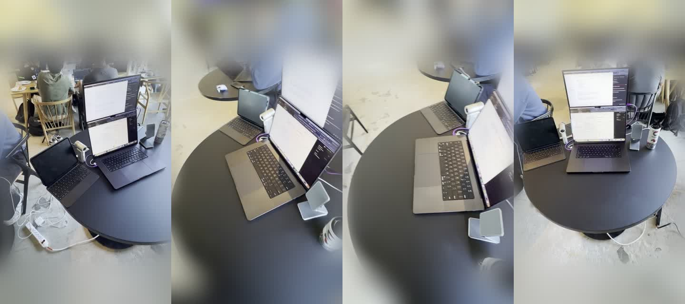

# ArgonTwin

**Your desk, rehearsed by robots before hardware.**

Film a table with your phone. ArgonTwin turns it into a physics twin, two ALOHA robot arms try a hand-over on it in MuJoCo, and when an attempt fails, Gemini 4 Argon reads the rendered frames and the measured numbers, explains why, and patches the plan. MuJoCo runs it again and decides.

Built at the [Gemini 4 Argon SF Hackathon](https://cerebralvalley.ai/events/~/e/gemini-4-argon-sf), Google DeepMind × Cerebral Valley, Oct 25, 2026. Problem Statement Two, *More Dimensions*: render what it made, watch the result, critique it against the goal, fix it in a loop. Everything in this repo was written during the event.

**[Try the verified Celsius replay](https://argon-twin.vercel.app)**: watch the screen collision, read Argon's repair, and replay the passing hand-over. The public demo is a recorded run; new model calls and physics runs need the local server (see [Run it](#run-it)).

**[Watch the 60-second tour](https://argon-twin.vercel.app/watch)** · 1920×1080, no audio. Phone capture, Gaussian splat, collision, Argon repair, and the passing hand-over.


*Screenshot of the local viewer right after live run 20261025-134505, attempt 2, Photoreal view. The chips under the title are that run's own live phases. Details under [Proof](#proof).*

## Where Google's tools do the work

| Tool | What it does in ArgonTwin | Verified |
|---|---|---|
| **Gemini 4 Argon** (`gemini-4-argon`) | The critic. Each call gets 20 rendered keyframes from four MuJoCo cameras plus the measured metrics and failed checks (about 26,000–28,000 input tokens), explains the failure chain, cites the frames it used, and returns a typed `PlanPatch`. Output is validated against strict Pydantic models, with one retry carrying the exact validation error. | Yes. Five live repairs, fail to pass, receipts below |
| **Antigravity managed agent** (`antigravity-preview-09-2026` running `gemini-4-argon`) | A robustness sweep in Google's sandbox (no network): 20 perturbations of a plan, screened geometrically. The result is accepted only after proof-of-execution checks (nonce, SHA-256 of the input, Linux platform, a `SANDBOX_PROOF` line in the executed code's output), then re-run in local MuJoCo. | One verified sweep, on the earlier scene without screens: 20 of 20 trials, local MuJoCo re-check passed at 3.74 mm. 46,651 input / 3,207 output tokens, 62.3 s |
| **Gemma 4 E4B**, fine-tuned | A small local repair model. Base and fine-tuned get the identical failed attempt; MuJoCo judges both fixes. Runs on the laptop, no cloud call. | Yes. Recorded local validation and live comparisons below |
| **MuJoCo** and **MuJoCo Menagerie** (Google DeepMind) | The physics referee and the ALOHA bimanual robot model. Same inputs, same result, every time. | Yes |
| **Google Colab** (T4 GPU) | Trains the Gaussian splat of the desk from the phone video. | Yes |

The model proposes. MuJoCo decides.

### Argon's 1M-token window and long output

Gemini 4 Argon shares one 1M-token window across input, thinking and output, and can write past 65,536 output tokens in one call. Where that shows up here:

- **Used today:** every critique is one multimodal call carrying 20 full keyframes, the scene, the plan, the metrics and the failed checks, about 27,000 input tokens. Argon reads them together and ties the failure to a specific plan parameter.
- **Built, not yet proven: the one-pass world build.** `argon.build_world` asks Argon to watch the whole desk video and write the scene (every object's size and position, with evidence), the first plan and declarative test checks in a single long-decode call, with `max_output_tokens` set to 262,144. No world build has run end to end yet, and no call has produced more than 65,536 output tokens. Two things stand in the way. In our calls, the Interactions API, where background long decodes run, rejected image input for `gemini-4-argon`, so the world build goes through `generateContent`, where output past 65,536 tokens isn't confirmed. And the world build still needs a run where the scene comes from the video rather than from a hand-written file. Token counts will be shown exactly as the API reports them, never padded.

## Why

You're bringing up a two-arm station on a table you've never used. Before anything runs on the real arms, you want to try the task in sim.

Every new table means a new sim. Measure the table. Measure the objects. Write the scene file. Tune the grasp and the hand-over. Days, every time.

So the step gets skipped. Untested motions run on real hardware. An unreachable hand-over or a dropped part costs arm time, or the arm.

ArgonTwin starts from a phone video of the table. MuJoCo runs two ALOHA arms through the task. When an attempt fails, Argon looks at the frames and the numbers, says why, and patches the plan. MuJoCo runs it again.

Google's own showcase for Argon's 3D work is [Desk Racer](https://aistudio.google.com/learn/building-3d-games-and-worlds-with-gemini-4-argon): a go-kart game built on top of a real desk, refined by a critic model that rates screenshots. Same kind of input here. Different finish line. ArgonTwin is done when fixed thresholds on MuJoCo's measurements say so, not when a model likes the picture.

## Where this goes

ArgonTwin is a prototype of physics-refereed robot planning: capture a real space, build a physics twin, let Gemini Argon propose, watch, critique and fix, and let deterministic physics judge and score. Today that is two ALOHA arms, one hand-over task and one real desk. The same loop is where model-driven robots are heading:

- **A safety gate for model-driven robots.** As robots are driven by language and vision models, a model's plan goes through a physics referee before any motor moves. The model proposes; physics decides. This is the part the prototype already shows.
- **Rehearsal in your own space.** Before a home robot or humanoid tries a task in a specific kitchen, office or workcell, it rehearses on a twin of that space, and physics rejects moves that hit or drop things.
- **Verified training data.** Each passing rollout is a physics-checked trajectory on a real scanned scene, the kind of data robot policies need. The Gemma pilot is a first step: trained on MuJoCo-verified repairs, it went from 4/12 to 11/12 in recorded local validation.
- **Scoring plans from policies and world models.** Learned world models predict plausible futures; a deterministic simulator measures them in newtons and millimeters. Argon sits between the two as the critic that reads frames and numbers and fixes the plan.

What doesn't carry over yet: the hand-over controller is scripted for ALOHA, grasps use the weld assist, and obstacles are fitted boxes. Other robot models can be swapped into the scene; a new robot or task still needs its own controller.

## The loop


- **Pass or fail is never the model's call.** `schemas.judge` checks measured MuJoCo numbers against fixed thresholds in `config.py`. The hand-over has to complete, the can can't drop, it has to land within 3 cm of the target and sit still, no arm can press into the table, and no arm or can may touch or pass through the screens and laptop. Argon can suggest extra checks. They show up on screen. They never change the verdict.
- **No answers in Argon's input.** The critique gets the scene's geometry on purpose, but no known good plan values, and live runs start from scenes whose own hand-over point is out of reach.
- **People stay in control.** Nothing here moves real hardware. A person can edit or break the plan before a run, and every attempt says whether its plan came from a person (`MANUAL`) or from Argon (`LIVE_ARGON`). The API key stays on the local machine.
- **Live and replay stay separate.** MuJoCo and every model call run locally. The hosted site only ever plays recorded runs, labeled as recorded. No keys there, no model calls.

## Proof

Recorded runs replay what already happened; the Run the loop button executes a new one live. Receipts are in `runs/<id>/` on the demo machine (`runs/` isn't published); the default run ships with the repo in `web/replay/`.

### Celsius can collision repair (the default demo)

Run `20261025-134505`, started from the viewer. Receipt: `web/replay/20261025-134505/verification.json`, shipped with its manifest, keyframes and rollout, so a fresh clone replays it. It's what the viewer opens on.

The task object is the actual Celsius can on the desk. Its Gaussians were segmented out of the trained splat and removed from the desk background, and in Photoreal they ride on the simulated cylinder through pickup, hand-over and placement. The right arm picks it up from where it really stood, (0.341, 0.187, 0), and the left arm places it.

| | Attempt 1 | Attempt 2 |
|---|---|---|
| Plan | Hand-over point (0.00, 0.21, 0.30), inside the screens | Argon's patch: approach clearance 0.06 m, lift height 0.18 m, hand-over point (0.05, −0.26, 0.26) |
| Arm against the screens | 216.194 N | 0 N, 0 mm |
| Can inside an obstacle | 9.986 mm, then dropped off the table | 0 mm |
| MuJoCo verdict | **Fail** | **Pass**, 5.051 mm from target, all three obstacle metrics zero |

Argon's call: response `generateContent:VmreaqT5OOP3-8YP5I6isA0`, 28,025 tokens in, 469 out, 12.22 s. Thinking tokens aren't reported by the API. The patched plan was rerun independently and passed at the same 5.051 mm. 18 focused physics and API tests pass.

One click on Run the loop, with no edits, reproduced it live as run `20261025-140956`: the same 216.194 N collision fail, a live Argon repair (19.36 s), and a pass at 4.164 mm with all obstacle metrics zero. Receipt: `runs/20261025-140956/verification.json`.

### Earlier collision repair

Run `20261025-133036`. Same fitted screens, a virtual can, the left arm picking up. Receipt: `runs/20261025-133036/verification.json`. Replay it at `?run=20261025-133036`.

| | Attempt 1 | Attempt 2 |
|---|---|---|
| Plan | Hand-written, hand-over point (0.00, 0.21, 0.30), inside the screens | Argon's patch: hand-over point (0.05, −0.26, 0.22), lift height 0.14 m |
| Arm against the screens | 95.5166 N, 2.873 mm inside | 0 N, 0 mm |
| Can inside an obstacle | 0.82 mm | 0 mm |
| Can on target | 5.6 mm off, which alone would pass | 1.019 mm off |
| MuJoCo verdict | **Fail**: the can landed, but an arm went through a screen to get it there | **Pass**, all three obstacle metrics zero |

Argon's call: response `generateContent:-GbeavXMIP6j_uMP68HCgAU`, 27,319 tokens in, 615 out, 23.68 s. The patched plan was rerun independently and passed with the same numbers.

### Repairs before the collision surfaces

These two runs used the table without fitted screens, so obstacle contact wasn't measured.

| Run | How it started | Argon's patch | Result |
|---|---|---|---|
| `verified-no-hint-20261025-124355` | Hand-written plan, hand-over point (1.05, −0.75, 0.55). Can fell, 58.2 cm off target | Hand-over point → (0.00, −0.08, 0.26). 26,007 tokens in, 468 out, 11.9 s. Response `generateContent:_VveasKdJoaz1MkPwr_K0Qw` | Pass, 1.49 cm from target. Whole loop 14.5 s. Both plans rerun independently, same fail and pass |
| `20261025-130553` (live, through the viewer) | Base plan, then Break the plan: hand-over point (1.2, 0.8, 0.6). Can missed the second arm, 19.3 cm off target | Hand-over point → (0.00, −0.05, 0.22), lift height → 0.20 m. 26,030 tokens in, 515 out, 34.1 s. Response `generateContent:N2HeasDfEImsjrEPj6LciAk` | Pass, 0.53 cm from target |

Each simulated attempt renders 20 keyframes from four cameras and takes about 0.7 to 1.9 s.

## Gemma 4: a small local repair model

Can a small open model, fine-tuned on a few dozen verified repairs, fix the same kind of failure locally?

- **Model:** Gemma 4 E4B (Q4_K_M) with a LoRA adapter, served locally by `llama-server` as an OpenAI-compatible endpoint. No cloud inference.
- **Data:** 36 synthetic, MuJoCo-verified repair pairs for training; 12 held-out cases from four other scene variants for testing. The examples cover hand-over-point and grasp-height corrections only, and the labels are scripted, simulator-verified repairs, not Argon's.
- **What it does and doesn't do:** it reads structured failure data (scene, plan, metrics, failed checks) and proposes a `PlanPatch`. It doesn't see the video, control motors or decide success.

**Recorded local validation, 12 held-out cases** (same runtime and JSON schema for both variants; response times exclude simulation):

| | MuJoCo passes | Valid patches | Median response |
|---|---|---|---|
| Base Gemma 4 E4B | 4 / 12 | 12 / 12 | 0.69 s |
| Fine-tuned | 11 / 12 | 12 / 12 | 0.81 s |

**Live comparison in the viewer** (Gemma repair test): one held-out failed attempt goes to both variants as an identical request, differing only in the adapter scale (0.0 base, 1.0 fine-tuned). Each patch is validated, applied to its own copy of the original plan and run through the same MuJoCo scene, seed and judge. On validation case `scene-13-variant-2`, two live runs (`compare-20261025-133604`, `compare-20261025-134202`) gave identical results:

| | Patch | MuJoCo verdict |
|---|---|---|
| Same failed attempt | | Fail: hand-over not completed, arm hit the table at 96.2 N |
| Base | pre-grasp clearance 0.08 → 0.12 m | **Fail**: arm hit the table at 442.0 N |
| Fine-tuned | grasp height offset −0.05 → 0.0 m | **Pass**, 4.0 mm from target |

Invalid output, timeouts and an unavailable model server are shown as such; no other model is substituted. An earlier base-only run through Ollama passed 8 of 12 with a different runtime setup, so it isn't comparable with the table above. A separate Colab evaluation (different runtime and base quantization) isn't combined with these numbers either.

## The stack

![The stack, by layer. Capture: iPhone video, COLMAP with 52 views, a Gaussian splat trained on a Colab T4 and cropped to the table. Reasoning: gemini-4-argon live critique, antigravity-preview-09-2026 managed agent, Gemma 4 E4B local repair model. Physics: MuJoCo 3.17 with fitted collision boxes, two ALOHA arms with mink 1.3. Contracts: Pydantic schemas 1.0.3, deterministic judge. Show: FastAPI and uvicorn, Three.js viewer with real ALOHA meshes, Gold, Solid and Photoreal views. Host: verified recorded Celsius replay on Vercel.](docs/stack.svg)

| Layer | What runs it | Why this one |
|---|---|---|
| Capture | iPhone 17 Pro Max, 0.5x ultra wide, 1080p60. COLMAP for camera poses, then a Gaussian splat trained on a Colab T4 (1,500 steps, 52 views) and cropped to the table | The ultra wide clip orbits the whole table in 10 seconds. The crop keeps everyone else at the event out of the public file |
| Reasoning | `gemini-4-argon` (multimodal `generateContent` for the critique). `antigravity-preview-09-2026` managed agent with Argon. Gemma 4 E4B with a LoRA adapter, served locally | Argon reads 20 frames and the metrics in one call and returns a typed patch |
| Physics | MuJoCo 3.17, `mink` 1.3 for inverse kinematics, the ALOHA bimanual model from MuJoCo Menagerie via `robot_descriptions` 3.3 | A deterministic referee. Same inputs, same result, every time |
| Contracts | Pydantic models frozen at 1.0.3 in `schemas.py` (every number finite; 1.0.2 added obstacle contact metrics; 1.0.3 adds optional fields used by the Celsius can scene), thresholds in `config.py` | Every model output is checked against the same strict contract before it touches the plan |
| Show | FastAPI + uvicorn, Three.js 0.170, `gaussian-splats-3d` 0.4.7, Archivo type | One screen. The scene, the verdict, Argon's critique, and the loop in order |
| Host | Vercel for the public page. The event API key lives in a password manager, mounted as a local `.env` | Public page holds no secrets. The key never touches git |

### How the 3D twin was built from the 10 second phone video




*Four frames (`0001`, `0018`, `0034`, `0050`) from the 10.4 s iPhone walkthrough (`IMG_1272.MOV`). Attendee faces and the surrounding room are blurred via macOS Apple Vision (`VNGeneratePersonSegmentationRequest` + `VNDetectFaceRectanglesRequest`) before publishing.*

1. **Camera poses and a sparse point cloud (`capture/prepare_local.py`, `pycolmap`), on a laptop:** 52 frames at 5 fps from the clip. COLMAP matches features across them, registers all 52 views, and solves the camera path plus a sparse cloud of colored 3D points.
2. **Gaussian splat (`capture/train_colab.py`, `gsplat` 1.5.3), on a Colab T4:** training starts only from points seen in at least 3 views with reprojection error under 3 px, which leaves 3,456 starting points. 1,500 steps grow them into 68,192 Gaussians, each with a position, a 3D scale, a rotation, a color and an opacity. The measured training loop took 10.0 s (13.4 s for the whole script run, not counting Colab setup or export), per `runs/photoreal-20261025/output/report.json`. The splat is then cropped to the table, so only 17,157 desk Gaussians ship (`web/assets/desk.splat`). For the Celsius can demo, 976 can and halo Gaussians come out of that desk (`web/assets/desk-without-celsius.splat`) and the can's own 943 ride on the simulated can (`web/assets/celsius-can.splat`).
3. **Collision boxes (`capture/fit_collision_scene.py`):** a splat looks real, but MuJoCo can't collide arms against a cloud of Gaussians. Panel corners were picked by hand in frame 0004, and a 2,000 iteration RANSAC plane fit runs on the 7 to 39 tracked points per panel (plane error 1.6 to 3.7 mm RMS, per `runs/collision-surfaces/fits.json`). The five boxes (`upper_screen`, `lower_screen`, `laptop_base`, `left_screen`, `left_base`) are inflated 8 mm and sit in the same frame as the splat, so MuJoCo measures real arm and can contact in newtons and millimeters.

## Try it

Start the server and open `http://127.0.0.1:8000`. The Celsius can repair above plays first: attempt 1 driving the can through the screens, then Argon's critique, then the pass. `?run=<id>` opens any other run, and a live run always takes over.

- **Run the loop** starts live from `examples/desk_celsius_demo.json`: the Celsius scene with the hand-over point inside the screens, so one click reproduces the collision, Argon's repair and the retry. The safe version, `examples/desk_celsius.json`, stays untouched.
- **Edit plan:** change the hand-over point or lift height. **Break the plan** puts the hand-over point back inside the screens. **Reset** goes back to the demo plan. **Apply and run** starts a live run with your edits (only the changes are sent, as `initial_patch`). Every run saves its own starting point in `runs/<id>/input.json`; example files are never changed.
- **Gemma repair test:** runs base and fine-tuned Gemma on the same failed attempt and replays both outcomes on the stage. Needs the local Gemma server.
- **Collision surfaces** outlines the table, laptop and screens exactly where MuJoCo placed them, so you can check them against the splat.
- **The loop rail** steps through attempt, critique, attempt. The progress strip shows each live phase: running, judged, Argon diagnosing, patch, done. The verdict appears after each replay finishes.
- **Gripper view** follows the real gripper body closest to the can.
- **Gold / Solid / Photoreal:** Gold draws the simulation's own geometry as dots (stylized, not captured). Blue dots are the real desk from the video. Photoreal shows the trained desk splat with the simulated arms on top, and hides the collision boxes so they don't cover the real screens.
- **`?variant=celsius`** still works and opens the same default. The earlier collision demo is at `?run=20261025-133036`.
- Keys: ← → step, space replays, C gripper view, H front view, O collision surfaces, T cycles the views.

## Status

Every claim here has a receipt.

| Part | Status |
|---|---|
| Contracts (`schemas.py`, `config.py`) | Version 1.0.3. 1.0.2 added three optional obstacle metrics (arm contact force, arm penetration, can penetration); runs from before the screens were fitted read as not measured, never as collision free. 1.0.3 adds optional fields (which arm picks up, per-scene and per-object splats) used by the Celsius can scene |
| Repair loop and viewer (`loop.py`, `server.py`, `web/`) | Live collision repairs verified in the browser: `20261025-134505` (the default), its one-click reproduction `20261025-140956`, and `20261025-133036`. Plan editor, live progress, gripper view, collision outlines, three views, the real can's Gaussians on the moving can |
| Physics (`sim.py`, `tests/`) | Real ALOHA hand-over in MuJoCo with weld grasp assist, fitted screen and laptop collision boxes, and measured arm and can contact. 20 keyframes per attempt from four cameras. 18 focused physics and API tests pass |
| Argon critique (`argon.py`) | Verified in five live repairs, all without passing-answer hints. The world build from video isn't verified yet |
| Managed agent (`managed_agent.py`) | One verified sweep with proof-of-execution checks and a local MuJoCo re-check, on the earlier scene without screens |
| Gemma 4 repair model (`gemma_local.py`, `compare.py`) | Fine-tuned 11/12 vs base 4/12 in recorded local validation; live base vs fine-tuned comparison in the viewer |
| Desk splat | Trained on a Colab T4, 17,157 Gaussians after the crop, aligned to the sim table by fitting the keyboard plane and table rim. Soft, with some floaters |
| Hosted replay | [argon-twin.vercel.app](https://argon-twin.vercel.app) serves the verified Celsius collision repair, labeled with its recording time. Gold, Solid, Photoreal and the attempt/critique rail are interactive; model calls and MuJoCo stay local |

## What's not working yet

Every repair so far starts from a hand-written scene. Argon building the scene straight from the video, the long-output world build, isn't verified yet.

The collision boxes are fitted, not scanned. Panel corners were picked by hand in one video frame (0004.jpg), each box is inflated 8 mm and drawn to enclose the screen's tilt. Surfaces the video never saw are uncertain.

Grasping uses a conditional weld. Once a gripper closes on the can, a MuJoCo weld holds it instead of fingertip friction. The viewer flags it on every attempt. The can is still checked against the screens, so the weld can't carry it through one.

The Celsius can's size and mass are approximate: its center comes from the label in the photos, its radius and height are estimates, and its mass is assumed.

The desk splat is soft and has floaters on the tabletop. Its fit to the sim table assumes a 0.8 m table.

The Gemma model is a narrow pilot: two repair types, mostly restoring a known good value.

## Run it

Python 3.12. A fresh clone opens on the recorded Celsius run in `web/replay/`; Run the loop needs a `GEMINI_API_KEY`.

```bash
pip install -r requirements.txt
uvicorn server:app --port 8000                              # live viewer at http://127.0.0.1:8000
python loop.py --scene examples/desk_celsius_demo.json      # the Celsius collision demo, live
python compare.py --case scene-13-variant-2                 # base vs fine-tuned Gemma (needs the local Gemma server)
python export_replay.py <run_id>                            # copy a finished run into web/replay/
```

`http://127.0.0.1:8000/?run=<run_id>` opens a specific run. `GEMINI_API_KEY` comes from the environment or a local `.env`, which is never committed.

## Built on

- [Gemini 4 Argon](https://blog.google/innovation-and-ai/models-and-research/gemini-models/gemini-4-argon/), the Antigravity managed agent and Gemma 4 from Google DeepMind
- [MuJoCo](https://github.com/google-deepmind/mujoco) and the ALOHA model from [MuJoCo Menagerie](https://github.com/google-deepmind/mujoco_menagerie)
- [mink](https://github.com/kevinzakka/mink) for inverse kinematics
- [COLMAP](https://colmap.github.io/) and [gsplat](https://github.com/nerfstudio-project/gsplat) for the desk scan, trained on Google Colab
- [Three.js](https://threejs.org/) and [gaussian-splats-3d](https://github.com/mkkellogg/GaussianSplats3D) for the viewer

Full design and contracts: [`docs/BUILD-SPEC.md`](docs/BUILD-SPEC.md).
